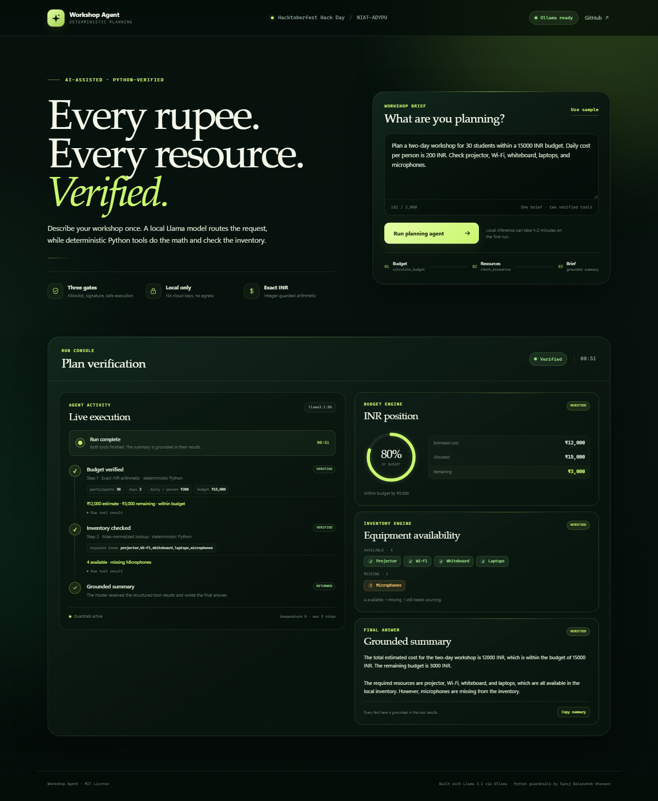
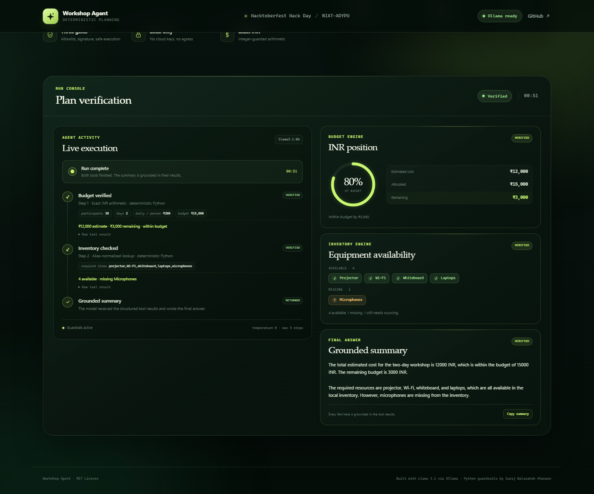
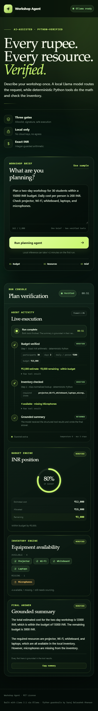

# Live Demo Evidence

Verified on **26 October 2026** as part of the Hacktoberfest Hack Day -
NIAT-ADYPU submission.

## Environment

- Windows 11
- Python 3.14.7
- Flask 3.1.3
- Ollama 0.40.11
- Model: `llama3.1:8b` (4.9 GB)
- Ollama endpoint: `http://localhost:11434`
- Browser: Google Chrome 155.0.8059.85, headless run with JavaScript enabled

## Browser interface

### Command

```powershell
.\venv\Scripts\python.exe web_app.py
```

Open <http://127.0.0.1:5000>, keep the preloaded sample brief, and select
**Run planning agent**.

### Result

The browser received the following substantive NDJSON event sequence from
`POST /api/plan` (periodic heartbeat events during model calls are omitted for
readability):

```text
accepted
session
heartbeat
status (calculate_budget)
tool_call calculate_budget
tool_result calculate_budget
heartbeat
status (check_resources)
tool_call check_resources
tool_result check_resources
status (final summary)
final
```

The streamed result populated the interface with:

- Estimated cost: INR 12,000
- Budget: INR 15,000
- Remaining: INR 3,000
- Budget used: 80%
- Available: projector, Wi-Fi, whiteboard, laptops
- Missing: microphones
- Final summary: verified after both tools completed

The first browser run completed in 53 seconds and the repeat run in 51 seconds.
Both runs produced the same verified figures. Browser checks at 1440px desktop
and 390px mobile showed no horizontal overflow and no console errors.

### Screenshots



The run console in detail:



Mobile layout:



## Command-line run

### Command

```powershell
.\venv\Scripts\python.exe app.py
```

### Tool trace

```text
INFO Step 1 REQUEST calculate_budget {'daily_cost_per_person': 200, 'days': 2, 'participants': 30, 'budget': 15000}
INFO Step 1 RESULT calculate_budget {'currency': 'INR', 'total_estimated_cost': 12000, 'budget': 15000, 'remaining_budget': 3000, 'within_budget': True}
INFO Step 2 REQUEST check_resources {'required_items': 'projector,Wi-Fi,whiteboard,laptops,microphones'}
INFO Step 2 RESULT check_resources {'available': ['projector', 'wi-fi', 'whiteboard', 'laptops'], 'missing': ['microphones']}
```

The two tool calls happened in the required order. The host exposed each tool
only for its allowed turn. The model did not perform the arithmetic or invent
inventory.

### Model-generated final summary

> The total estimated cost for the two-day workshop is 12000 INR, which is
> within the budget of 15000 INR. The remaining budget is 3000 INR.
>
> The required resources are projector, Wi-Fi, whiteboard, and laptops, which
> are all available in the local inventory. However, microphones are missing
> from the inventory.

## Reproducibility

The CLI run was repeated twice with the same tool order, budget figures,
availability list, and missing-item result. The browser interface was then run
twice more and produced the same verified facts. The interface does not compute
or infer any budget or inventory value; it renders the structured results
emitted by the deterministic Python tools.

The deterministic tool output can be checked without Ollama by running:

```powershell
.\venv\Scripts\python.exe demo_tools.py
```

The agent event path and Flask stream can be checked with mocked clients:

```powershell
.\venv\Scripts\python.exe -m unittest discover -s tests -t . -v
```

All 17 regression tests pass.
